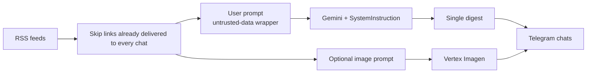

# Neuro-Occultist Bot

A small Go Telegram bot that reads public RSS feeds, asks an LLM to write a short mystical digest, and optionally illustrates it with Vertex AI Imagen. It is a compact example of a production-shaped **LLM pipeline**: ingest → filter → prompt → generate → deliver. The sequence of steps is fixed. The model does not choose tools or take autonomous actions. LLM and Telegram clients sit behind interfaces so the core path can be tested without live network calls.

Operator-facing command copy in this sample is English. The LLM is instructed to write the digest itself in Russian.

## What it does

- **Ingest** headlines from configured RSS/Atom feeds.
- **Filter** items that were already delivered to a given chat (Firestore, or an in-memory store locally). Delivery is per chat, so a failed recipient can be retried without resending to chats that already got the post.
- **Generate** one short post with Gemini. Style and policy go in `GenerativeModel.SystemInstruction`. Headlines are sanitized and wrapped as `<untrusted-data>` in the user prompt. That wrapping reduces prompt-injection risk; it is not a guarantee that the model will ignore hostile text in a title.
- **Deliver** the post to Telegram: a personal preview (`/rss_summary`) or an authenticated `POST /broadcast` to saved chats. Personal commands do not change broadcast delivery state.
- **Optional images** from Vertex AI Imagen (`/vision`, `/news_vision`, and broadcast).

Chats are recorded when the bot is added as a member or administrator.

## Pipeline



## Project layout

| Path | Role |
|------|------|
| `cmd/bot` | Process wiring, HTTP server timeouts, graceful shutdown |
| `internal/config` | Environment loading |
| `internal/llm` | Gemini client and prompt construction |
| `internal/rss` | Concurrent feed fetch |
| `internal/service` | RSS → filter → LLM orchestration |
| `internal/bot` | Telegram commands, webhook, rate-limited broadcast |
| `internal/handlers` | `/healthz`, `/webhook`, `/broadcast` |
| `internal/image` | Vertex Imagen (optional) |
| `internal/storage` | Firestore or in-memory store |

## Run locally

Requires Go 1.26+.

```bash
cp .env.example .env
# edit .env: TELEGRAM_TOKEN and GEMINI_API_KEY
make run
```

`BOT_MODE=polling` (the example default) uses Telegram long polling. No public URL is required. Open the bot in Telegram and send `/ping`. In polling mode the `/webhook` route is disabled.

Firestore is optional. If `FIRESTORE_PROJECT_ID` is unset, chats and per-chat delivery records live in memory and reset on restart.

### Docker

```bash
cp .env.example .env
docker compose up --build
# or: make docker-build && make docker-run
```

### Webhook mode

Expose HTTPS (Cloud Run, ngrok, Caddy) and set:

```bash
BOT_MODE=webhook
WEBHOOK_SECRET=<long random value>
```

Point Telegram at `/webhook`:

```bash
curl -sS -X POST "https://api.telegram.org/bot${TELEGRAM_TOKEN}/setWebhook" \
  --data-urlencode "url=https://your-host/webhook" \
  --data-urlencode "secret_token=${WEBHOOK_SECRET}"
```

Telegram sends `X-Telegram-Bot-Api-Secret-Token`. Requests without the matching secret are rejected. A missing secret is treated as unauthorized, not as an open endpoint.

## Tests and lint

```bash
make test
make vet
make lint   # golangci-lint
```

Unit tests mock the LLM (`ComposePost`), intercept Telegram Bot API calls with a fake HTTP transport, and pin Gemini requests to an `httptest` server to assert that the API key is attached. RSS parsing is covered with `httptest` feeds. No live API keys are required.

## Configuration

| Variable | Required | Description |
|----------|----------|-------------|
| `TELEGRAM_TOKEN` | yes | Bot token from [@BotFather](https://t.me/BotFather) |
| `GEMINI_API_KEY` | yes | Gemini API key |
| `BOT_MODE` | no | `polling` (local) or `webhook` (default if unset: `webhook`) |
| `PORT` | no | HTTP port, default `8080` |
| `WEBHOOK_SECRET` | webhook mode | Shared secret for Telegram webhook verification |
| `BROADCAST_SECRET` | no | If set, `POST /broadcast` requires `X-Broadcast-Secret`. If unset, the route is disabled (404) |
| `ADMIN_USER_IDS` | no | Comma-separated Telegram user IDs for `/status` and `/chats` |
| `GEMINI_MODEL` | no | Default `gemini-3.5-flash` |
| `RSS_FEEDS` | no | Comma-separated feed URLs |
| `FIRESTORE_PROJECT_ID` | no | GCP project for persistence |
| `FIRESTORE_DATABASE` | no | Firestore database id, default `(default)` |
| `VERTEX_PROJECT_ID` | no | Enables Imagen; uses Application Default Credentials |
| `VERTEX_LOCATION` | no | Default `us-central1` |
| `VERTEX_IMAGE_MODEL` | no | Default `imagen-3.0-generate-001` |
| `VERTEX_ASPECT_RATIO` | no | Default `1:1` |

Copy `.env.example` to `.env`. Never commit `.env` or service-account JSON.

## HTTP API

| Method | Path | Auth | Purpose |
|--------|------|------|---------|
| `GET` | `/healthz` | none | Liveness |
| `POST` | `/webhook` | `X-Telegram-Bot-Api-Secret-Token` | Telegram updates (webhook mode only) |
| `POST` | `/broadcast` | `X-Broadcast-Secret` | Fetch undelivered RSS, generate one post (and optional image), send to saved chats |

Example broadcast (Cloud Scheduler, cron, or `curl`):

```bash
curl -sS -X POST "https://your-host/broadcast" \
  -H "X-Broadcast-Secret: ${BROADCAST_SECRET}"
```

Failed or partial delivery is not recorded as success. The next run retries only chats that have not received the links yet.

## Deploy (Cloud Run)

The workflow `.github/workflows/deploy.yml` is **manual** (`workflow_dispatch`) so a public clone cannot push to someone else’s project.

GitHub Actions secrets:

- `GCP_PROJECT_ID`, `GCP_REGION`, `CLOUD_RUN_SERVICE`, `GCP_SA_KEY`
- `TELEGRAM_TOKEN`, `WEBHOOK_SECRET`, `GEMINI_API_KEY`
- optional: `RSS_FEEDS`, `BROADCAST_SECRET`, Vertex image settings

The service must be reachable by Telegram (`--allow-unauthenticated` on the HTTPS endpoint). After deploy, the workflow sets the webhook to `https://<service>/webhook`.

CI on every push/PR (`.github/workflows/ci.yml`) runs `go vet`, `go test`, and `golangci-lint`.

## Telegram commands

| Command | Who | Effect |
|---------|-----|--------|
| `/start`, `/ping` | anyone | Intro / liveness |
| `/rss_summary` | anyone | Personal digest of current RSS items (does not mark channel delivery) |
| `/vision <text>` | anyone | Imagen illustration of a description |
| `/news_vision` | anyone | Illustration of current headlines (does not mark channel delivery) |
| `/status`, `/chats` | `ADMIN_USER_IDS` only | Store/image status and saved chat list |

User-facing errors are generic. Details go to process logs, not chat.

## Security notes

- Secrets belong in the environment or a secret manager, never in git.
- User text and RSS titles are sanitized before they reach Gemini or Imagen. `<untrusted-data>` wrapping plus a separate system instruction lowers prompt-injection risk; it does not make injection impossible.
- `/webhook` is disabled in polling mode. In webhook mode a missing or wrong secret is `401`.
- `/broadcast` is off unless `BROADCAST_SECRET` is set.
- The HTTP server sets read/write/idle timeouts; webhook bodies are capped at 1 MiB.
- Admin commands that list chats are gated by Telegram user id.
