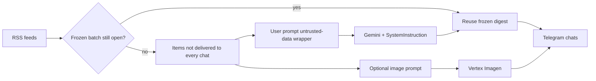

# Neuro-Occultist Bot

A small Go Telegram bot that reads public RSS feeds, asks Gemini to write one short mystical digest, and optionally illustrates it with Vertex AI Imagen. The sequence is fixed: ingest → filter → prompt → generate → deliver. The model does **not** choose tools or take autonomous actions.

It ran on a public Telegram channel: [Neuro-Occultist](https://t.me/Neuro_Occultist). Channel posts are in **Russian**, which is the default `DIGEST_LANGUAGE` (`ru` / `en` aliases). Operator-facing command copy in this sample is English.

This repository is a public code sample of that **pipeline**, not an agent platform.

## What it does

- **Ingest** headlines from configured RSS/Atom feeds (one bad feed is skipped).
- **Freeze a broadcast batch.** `POST /broadcast` composes one post from items that are not yet delivered to every saved chat, then stores that post and its links. New RSS items wait until every saved chat has every link in the frozen batch. Personal commands (`/rss_summary`, `/news_vision`) ignore the frozen batch and do not write delivery state.
- **Generate** one short post with Gemini. Style and policy go in `GenerativeModel.SystemInstruction`. Headlines are sanitized and wrapped as `<untrusted-data>` in the user prompt. That wrapping lowers prompt-injection risk; it is not a guarantee.
- **Deliver** the frozen post to saved chats. A chat is skipped when it already has **all** links in that batch. Telegram acceptance and store writes are tracked separately (see [Delivery semantics](#delivery-semantics)).
- **Optional images** from Vertex AI Imagen (`/vision`, `/news_vision`, and broadcast). If Imagen fails on broadcast, the text still sends.

Chats are recorded when the bot is added as a member or administrator.

## Pipeline



## Demo

Live output: [t.me/Neuro_Occultist](https://t.me/Neuro_Occultist) (Russian). Open the channel for real posts. This repo does not embed a Telegram screenshot.

### Offline example (hand-written fixture, not a live run)

The headlines and post below are a **hand-written fixture** so a reviewer can see the pipeline shape without GCP credentials. They are **not** a paste from the channel and were **not** produced by Gemini in CI.

**Input headlines**

- Go 1.23 released with range-over-func
- Linux 6.11 lands with network stack tweaks

**Example post in Russian** (what the bot generates by default; `DIGEST_LANGUAGE=Russian`)

> В цифровом эфире снова вспыхнули два сигнала: Go 1.23 открыл range-over-func, а ядро Linux 6.11 подкрутило сетевой стек. Нейро-Оккультист не выдумывает релизы — только слушает ленту. ✨ Следите за каналом.

**English translation for reviewers** (not sent by the bot unless `DIGEST_LANGUAGE` is English; not a second model run)

> Two signals in the feed: Go 1.23 shipped range-over-func, and Linux 6.11 tuned the network stack. Neuro-Occultist does not invent releases — it only listens to the headlines. ✨ Follow the channel.

The live binary still needs real `TELEGRAM_TOKEN` and `GEMINI_API_KEY`. Contributors can exercise the code without keys via `make test` (mocked LLM and Telegram).

## Project layout

| Path | Role |
|------|------|
| `cmd/bot` | Process wiring, HTTP server timeouts, graceful shutdown |
| `internal/config` | Environment loading |
| `internal/llm` | Gemini client and prompt construction |
| `internal/rss` | Concurrent feed fetch |
| `internal/service` | RSS → filter → LLM orchestration, frozen digest |
| `internal/bot` | Telegram commands, webhook, rate-limited broadcast |
| `internal/handlers` | `/healthz`, `/webhook`, `/broadcast` |
| `internal/image` | Vertex Imagen (optional) |
| `internal/storage` | Firestore or in-memory store |
| `eval/` | Fixed headline fixtures and eval criteria (no live scores) |

## Run locally

Requires Go 1.26+. The process always talks to real Telegram and Gemini; there is no offline provider in `cmd/bot`.

```bash
cp .env.example .env
# edit .env: TELEGRAM_TOKEN and GEMINI_API_KEY
make run
```

`BOT_MODE=polling` (the example default) uses Telegram long polling. No public URL is required. Open the bot in Telegram and send `/ping`. In polling mode the `/webhook` route is disabled.

If `BOT_MODE` is unset, the code defaults to `webhook` (meant for Cloud Run).

Firestore is optional. If `FIRESTORE_PROJECT_ID` is unset, chats, delivery records, and the frozen digest live in memory and reset on restart.

### Docker

```bash
cp .env.example .env
docker compose up --build
```

### Webhook mode

Expose HTTPS (Cloud Run, ngrok, Caddy) and set:

```bash
BOT_MODE=webhook
WEBHOOK_SECRET=<long random value>
```

Point Telegram at `/webhook`:

```bash
curl -sS -X POST "https://api.telegram.org/bot${TELEGRAM_TOKEN}/setWebhook" \
  --data-urlencode "url=https://your-host/webhook" \
  --data-urlencode "secret_token=${WEBHOOK_SECRET}"
```

Telegram sends `X-Telegram-Bot-Api-Secret-Token`. Requests without the matching secret are rejected. A missing secret is treated as unauthorized, not as an open endpoint.

## Tests and lint

```bash
make test
make vet
make lint   # golangci-lint
go test -race ./...
```

Unit tests mock the LLM (`ComposePost`), intercept Telegram Bot API calls with a fake HTTP transport, and pin Gemini requests to an `httptest` server to assert that the API key is attached. RSS parsing is covered with `httptest` feeds. No live API keys are required.

## Configuration

| Variable | Required | Description |
|----------|----------|-------------|
| `TELEGRAM_TOKEN` | yes | Bot token from [@BotFather](https://t.me/BotFather) (`TELEGRAM_BOT_TOKEN` also accepted) |
| `GEMINI_API_KEY` | yes | Gemini API key (`GOOGLE_API_KEY` also accepted) |
| `DIGEST_LANGUAGE` | no | Digest language in the system instruction. Default `Russian`. Aliases: `ru`, `en` |
| `BOT_MODE` | no | `polling` (local) or `webhook` (default if unset: `webhook`) |
| `PORT` | no | HTTP port, default `8080` |
| `WEBHOOK_SECRET` | webhook mode | Shared secret for Telegram webhook verification |
| `BROADCAST_SECRET` | no | If set, `POST /broadcast` requires `X-Broadcast-Secret` (or `X-Cron-Token`). If unset, the route is 404 |
| `ADMIN_USER_IDS` | no | Comma-separated Telegram user IDs for `/status` and `/chats` |
| `GEMINI_MODEL` | no | Default `gemini-3.5-flash` |
| `RSS_FEEDS` | no | Comma-separated feed URLs (`FEEDS` also accepted) |
| `FIRESTORE_PROJECT_ID` | no | GCP project for persistence (`GOOGLE_CLOUD_PROJECT` also accepted) |
| `FIRESTORE_DATABASE` | no | Firestore database id, default `(default)` |
| `VERTEX_PROJECT_ID` | no | Enables Imagen; uses Application Default Credentials |
| `VERTEX_LOCATION` | no | Default `us-central1` |
| `VERTEX_IMAGE_MODEL` | no | Default `imagen-3.0-generate-001` |
| `VERTEX_ASPECT_RATIO` | no | Default `1:1` |

Copy `.env.example` to `.env`. Never commit `.env` or service-account JSON.

## HTTP API

| Method | Path | Auth | Purpose |
|--------|------|------|---------|
| `GET` | `/` | none | Name probe |
| `GET` | `/healthz` | none | Liveness |
| `POST` | `/webhook` | `X-Telegram-Bot-Api-Secret-Token` | Telegram updates (webhook mode only) |
| `POST` | `/broadcast` | `X-Broadcast-Secret` | Reuse or build a frozen digest, optional image, send to saved chats |

Example broadcast (Cloud Scheduler, cron, or `curl`):

```bash
curl -sS -X POST "https://your-host/broadcast" \
  -H "X-Broadcast-Secret: ${BROADCAST_SECRET}"
```

`204` means there were no headlines in the frozen/new batch. No saved chats is `500` (`no chats to broadcast to`), not `204`. Any send failure, including a Telegram success that did not fully persist delivery state, is also `500`.

## Delivery semantics

There is **no** shared transaction between Telegram and the store. Exactly-once delivery is not guaranteed.

- After Telegram accepts a send, the bot writes one delivery record per RSS link for that chat. If a write fails, `Broadcast` returns an error (`ErrStateSave`). It does **not** report full success. The next run may still send that chat again, because the missing records look like “not delivered”. Returning the error does not remove that duplicate window.
- A multi-link batch can be **partially** saved (first link written, later link failed). That chat is not treated as complete.
- While a frozen digest is open, a new headline `Y` does not get merged into a retry of `X`. Recipients who already received `X` are skipped; `Y` becomes a later batch.
- The frozen batch completes when every **active** chat has those links. A chat that left, kicked the bot, or returns a permanent Telegram error (kicked/blocked/not a member/chat not found) is removed from the recipient list. That chat is **not** marked delivered. Temporary send errors stay retryable.
- `FetchUnsent` treats a link as “done” only when **every active** chat has it. Per-chat skipping at send time uses `chatHasAll` on the frozen link set.

## Telegram commands

| Command | Who | Effect |
|---------|-----|--------|
| `/start`, `/ping` | anyone | Intro / liveness |
| `/rss_summary` | anyone | Personal digest of current RSS items (does not mark channel delivery) |
| `/vision <text>` | anyone | Imagen illustration of a description |
| `/news_vision` | anyone | Illustration of current headlines (does not mark channel delivery) |
| `/status`, `/chats` | `ADMIN_USER_IDS` only | Store/image status and saved chat list |

User-facing errors are generic. Details go to process logs, not chat.

There is **no** per-user quota on `/rss_summary`, `/vision`, or `/news_vision`. Anyone who can message the bot can trigger Gemini or Imagen. Broadcast sends are rate-limited (~30 msg/s global, 1/s per chat).

## LLM eval

`eval/cases.json` holds 15 fixed headline sets (empty input, duplicates, prompt injection, caps). Criteria are listed in `eval/README.md`.

`go test ./internal/llm` checks prompt construction against that file. That is not a quality score.

Live GCP usage and eval numbers are being collected separately and are **not in this repository**. This revision does not record model id, example count, latency, tokens, or cost.

## Deploy (Cloud Run)

The workflow `.github/workflows/deploy.yml` is **manual** (`workflow_dispatch`) so a public clone cannot push to someone else’s project.

GitHub Actions secrets:

- `GCP_PROJECT_ID`, `GCP_REGION`, `CLOUD_RUN_SERVICE`, `GCP_SA_KEY`
- `TELEGRAM_TOKEN`, `WEBHOOK_SECRET`, `GEMINI_API_KEY`
- optional: `RSS_FEEDS`, `BROADCAST_SECRET`, Vertex image settings

The service must be reachable by Telegram (`--allow-unauthenticated` on the HTTPS endpoint). After deploy, the workflow sets the webhook to `https://<service>/webhook`. The workflow also sets `FIRESTORE_PROJECT_ID` and `VERTEX_PROJECT_ID` to the GCP project id.

CI on every push/PR (`.github/workflows/ci.yml`) runs `go vet`, `go test -race`, and `golangci-lint`.

## My contribution

I built this RSS → Gemini → Telegram pipeline and ran it on a public channel, [Neuro-Occultist](https://t.me/Neuro_Occultist). I checked quality by reading the posts in Telegram.

This repository is the public sample of that pipeline (Go, optional Firestore, optional Vertex Imagen, tests without live keys). Default digest language is Russian because that is the channel’s language.

Hardening for the public sample (delivery retries, docs, eval fixtures) was done with Cursor agents and reviewed via pull request and CI.

## Design decisions

Observable in the code (not a biography):

- **Fixed pipeline, not an agent.** One RSS fetch, at most one Gemini completion per new batch, optional Imagen, then send. No tool calling, planner, or multi-step loop — cheaper and easier to test than an autonomous agent, and it matches what the binary does.
- **Frozen digest for retries.** Partial Telegram failure plus a new RSS item used to resend `X` to a chat that already got `X`. The pending batch keeps the composed post and link set until every **active** chat has those links. Dead recipients are dropped so they cannot stall new posts for everyone else.
- **Per-chat delivery hashes.** Success is recorded per `(chat, link)` so a failed recipient can be retried without a Telegram/store transaction.
- **System instruction vs user data.** Style/security sit in `SystemInstruction`; headlines are sanitized and wrapped. Defense in depth, not a proof of injection resistance.
- **Interfaces + `httptest`.** `llm.Composer`, `image.Generator`, and `storage.Store` let CI run without Gemini, Telegram, or Firestore.
- **Firestore as a small experiment.** Optional serverless state on GCP (chats, delivery records, frozen digest) while running on Cloud Run. Local and tests use memory. This was not a Postgres bake-off.

## Limitations

- **Duplicates after a save failure.** Telegram can accept a message while `MarkDelivered` fails. The error is returned; the next broadcast may send that chat again. If only some links in a batch are saved, the chat is not complete and the **whole frozen post** may be sent again (this sample does not rewrite a partial link set).
- **Store read errors look like “not delivered”.** A failed `WasDelivered` lookup skips the “already sent” check, so a transient read error can cause a resend.
- **Concurrent broadcasts / multiple instances.** Two overlapping `/broadcast` runs can compose or send the same batch. There is no leader election or lease. The frozen batch stores post and links, not a snapshot of recipients: a chat added mid-retry receives the frozen post.
- **Restricted / muted chats are not auto-dropped.** Only leave/kick member updates and a small set of permanent Telegram API errors remove a recipient. A 403 that is not kick/block still retries.
- **Public generation commands are uncapped.** `/rss_summary`, `/vision`, and `/news_vision` have timeouts but no spend quota.
- **In-memory mode loses state on restart** (chats, delivery records, frozen digest). If Firestore is configured but the client cannot be created, the process currently falls back to memory and logs that fact.
- **No Gemini retries or token budget** beyond prompt caps (8 items, 400 runes/item) and a 45s LLM timeout.
- **RSS merge is not date-sorted**; a single failing feed is skipped.
- **Firestore and live Vertex HTTP are not unit-tested** (no emulator in CI).

## Security notes

- Secrets belong in the environment or a secret manager, never in git.
- User text and RSS titles are sanitized before they reach Gemini or Imagen. `<untrusted-data>` wrapping plus a separate system instruction lowers prompt-injection risk; it does not make injection impossible.
- `/webhook` is disabled in polling mode. In webhook mode a missing or wrong secret is `401`.
- `/broadcast` is off unless `BROADCAST_SECRET` is set.
- The HTTP server sets read/write/idle timeouts; webhook bodies are capped at 1 MiB.
- Admin commands that list chats are gated by Telegram user id.

## License

[MIT](LICENSE)
